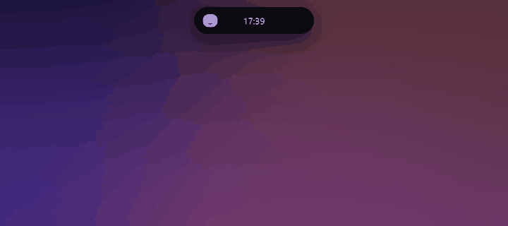
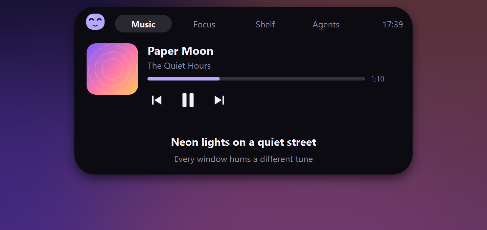
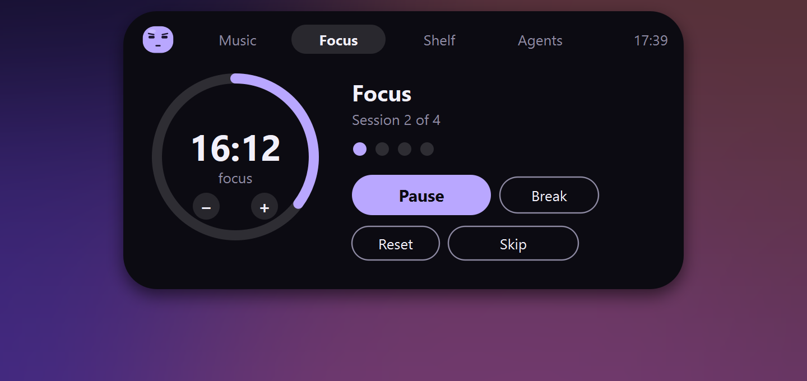
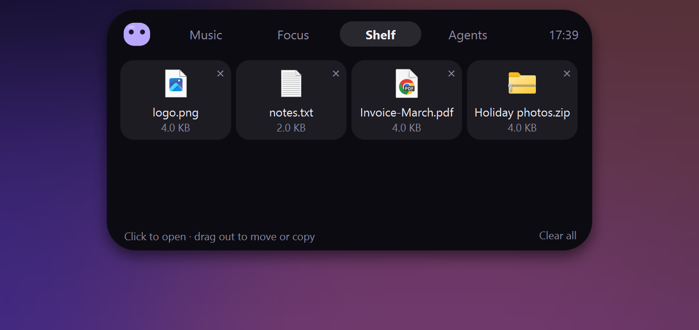
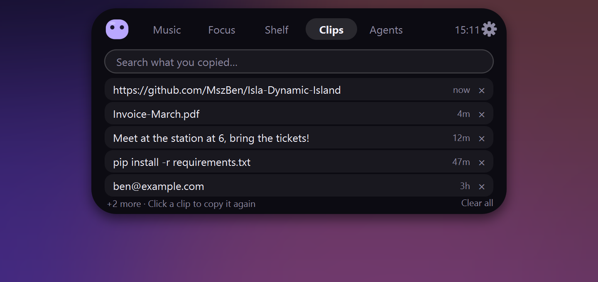
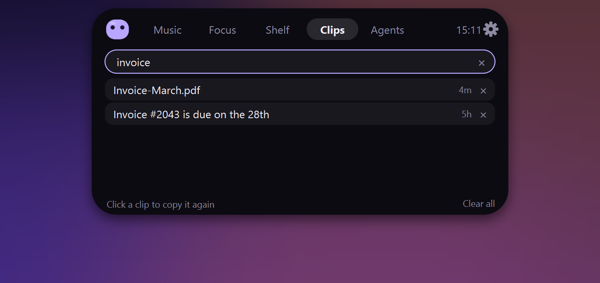
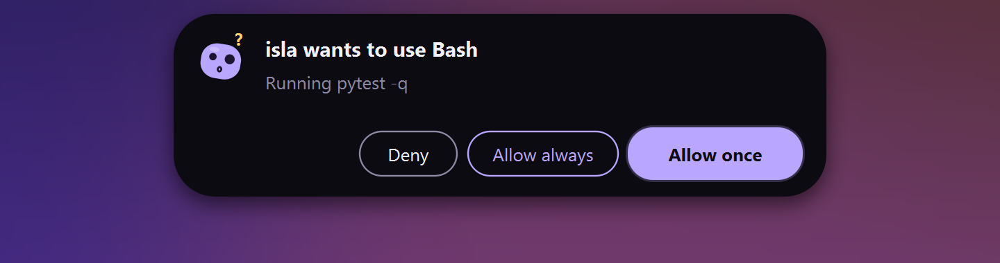
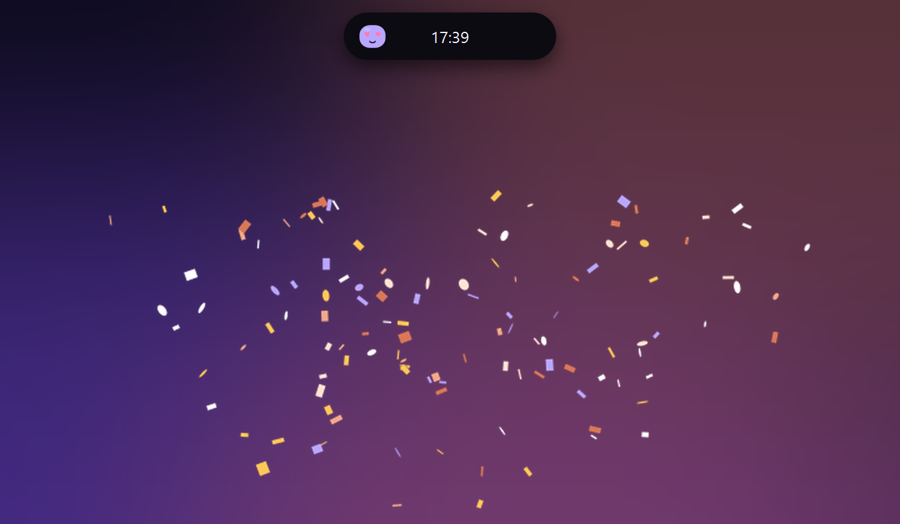
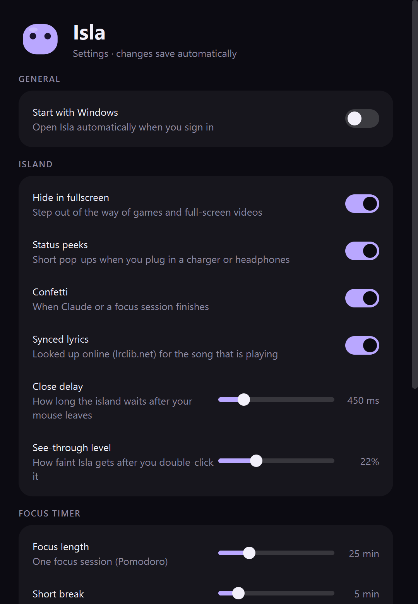

<div align="center">


<br>

[](https://github.com/MszBen/Isla-Dynamic-Island/releases/latest)
&nbsp;

&nbsp;

&nbsp;
[](LICENSE)
&nbsp;
[](https://ko-fi.com/E6E229VTTJ)

<br>



**A little island at the top of your screen that shows your music, keeps you focused, holds your files,<br>remembers what you copy, and lets you watch and approve [Claude Code](https://claude.com/claude-code) without leaving what you're doing.**

[**⬇ Download Isla.exe**](https://github.com/MszBen/Isla-Dynamic-Island/releases/latest) &nbsp;·&nbsp; [Features](#-features) &nbsp;·&nbsp; [Tips](#-tips) &nbsp;·&nbsp; [Claude Code](#-connect-claude-code) &nbsp;·&nbsp; [Build it yourself](#-build-it-yourself)

</div>

---

## 🚀 Get started

1. **[Download `Isla.exe`](https://github.com/MszBen/Isla-Dynamic-Island/releases/latest)** from the latest release.
2. **Double-click it.** There's nothing to install, and you don't need Python.
3. A short tour opens the first time. Hover over the island at the top of your screen and have a look around.

> [!NOTE]
> Windows may say *"Windows protected your PC"* the first time, because the app isn't code-signed yet.
> Click **More info → Run anyway**. Some antivirus tools are also wary of packaged Python apps. The source is all right here if you'd rather read it or [build it yourself](#-build-it-yourself).

Want it to start with Windows? **Settings → Start with Windows.**

---

## ✨ Features

<table>
<tr>
<td width="50%" valign="top">

### 🎵 Music, with lyrics
Shows what's playing in Spotify, your browser, and anything else that uses Windows media controls. Play, pause, skip, and seek. **Lyrics scroll in sync**, and clicking a line jumps to it.



</td>
<td width="50%" valign="top">

### 🍅 Focus timer
A Pomodoro timer that counts down right in the island, with a soft chime when it's time to rest. Change the length with **− / +** or the mouse wheel. Need a breather? **Break** pauses focus and **resumes it automatically** afterwards.



</td>
</tr>
<tr>
<td width="50%" valign="top">

### 📥 File shelf
Drop files on the island to keep them handy, then drag them out into any app, a chat, an email, or another folder. Files dropped together **stay grouped**: drag the whole group, **Ctrl+click** to pick several items (even from different groups) and drag them at once, or drag just one. Files aren't copied or moved; the shelf just remembers where they are.



</td>
<td width="50%" valign="top">

### 🤖 Claude Code, at a glance
See which session is working, **how many minutes it's been going and how many tokens it's used**. The island turns Claude orange and takes over from the music while it works.


</td>
</tr>
</table>

### 📋 Clipboard history <sup>new in 1.1</sup>

The **Clips** tab remembers what you copy and lets you **search** it. Click a clip to copy it again. If Windows' own clipboard history (**Win+V**) is turned on, those items show up here too. Copies from password managers are ignored, and clips are kept **in memory only**, so they're gone when Isla quits.

<table>
<tr>
<td width="50%"><br><sub>Everything you copied, newest first</sub></td>
<td width="50%"><br><sub>Type a few words to filter</sub></td>
</tr>
</table>

### ✅ Approve actions without switching windows

When Claude Code wants to run something, the request appears on the island. **Allow once** is the default; **Allow always** saves a rule so it stops asking; **Deny** says no. If you answer it in the terminal or another Claude window instead, the request clears from the island by itself.

<div align="center"></div>

### 🎉 The little touches

<table>
<tr>
<td width="33%" align="center"><br><sub><b>Charger</b> animation when you plug in</sub></td>
<td width="33%" align="center"><br><sub><b>Headphones</b> pop on with sound waves</sub></td>
<td width="33%" align="center"><br><sub><b>Confetti</b> when Claude or a focus session finishes</sub></td>
</tr>
</table>

- 🫧 **A mascot with moods**: it's happy when music plays, focused when Claude works, curious when it needs you, sleepy when you've been away, and dizzy if you poke it too much.
- 🖥️ **Your screen, your choice**: with more than one display, pick which one the island sits on in **Settings → Display**.
- ⚙️ **Settings one click away**: there's a cog right on the island. While Settings is open, the mascot gets her head opened up and worked on by a pair of robot arms.
- 👻 **Always within reach**: *double-click* the island and it fades to see-through, and clicks pass straight through to whatever it covered, until you move your mouse away.
- 🎮 **Stays out of the way**: it hides for fullscreen games and videos.
- 🔒 **Private**: no account, no telemetry. Everything stays on your PC. See [Privacy](#-privacy).

---

## 💡 Tips

| Do this | To get this |
|---|---|
| **Hover** over the island | It expands into **Music · Focus · Shelf · Clips · Agents** tabs |
| **Drop files** on it | They land on the shelf, grouped together |
| **Ctrl+click** shelf items | Pick several and drag them out at once |
| **Copy** something, open **Clips** | Search and re-copy anything from your clipboard history |
| **Double-click** it | See-through and click-through until you move away |
| **Click the cog** or **right-click** it | Settings, quick tour, quit |
| **Scroll** over the Focus tab | Make the timer shorter or longer |
| **Poke** the mascot | It reacts (a few pokes make it dizzy) |
| **Click the tray icon** | Settings (look under the ^ arrow if you can't see it) |

Every button also has a hover hint, so you can't get lost.

<details>
<summary><b>Settings</b></summary>
<br>
<div align="center"></div>

Everything saves the moment you change it. You can set the focus lengths, the chime, confetti and status pop-ups, how fast the island closes, how see-through it gets, lyrics, which display it sits on (when you have more than one), and starting with Windows.
</details>

---

## 🔌 Connect Claude Code

1. Open the **Agents** tab on the island and press **Connect** (or use **Settings → Claude Code → Connect**).
2. Restart any Claude Code sessions that were already open.
3. That's it. Start a session and it shows up on the island.

Isla adds a small relay to Claude Code's hooks in `~/.claude/settings.json` (a backup is made first, and your own hooks are left alone). If Isla isn't running, the relay does nothing, so **Claude Code is never blocked or slowed down by it**. You can disconnect any time from Settings.

---

## 🛡 Privacy

- No account, no analytics, no telemetry.
- The Claude Code connection only listens on `127.0.0.1` (your own PC) and never leaves it.
- The only online lookup is **lyrics**: the artist, title and length of the song playing are sent to [lrclib.net](https://lrclib.net). Turn it off in Settings.
- Clipboard history is kept in memory only and never written to disk. Copies from password managers are skipped.
- Your shelf, settings and a log live in `%APPDATA%\Isla`.

---

## 🧰 Troubleshooting

<details>
<summary><b>I can't find the island</b></summary>

It might be see-through (move your mouse away from it) or hidden because a fullscreen app is open. Look for the Isla icon near your clock (under the ^ arrow) and click it. Starting a second copy tells you Isla is already running.
</details>

<details>
<summary><b>Claude Code doesn't show up</b></summary>

The Agents tab should say **Waiting for Claude Code…**; if it offers **Connect**, press it. Then restart open Claude Code sessions. If something else is using port 47821, Isla tells you from the tray.
</details>

<details>
<summary><b>No lyrics</b></summary>

Not every song has synced lyrics on lrclib.net. Local files with missing tags can also be hard to match.
</details>

<details>
<summary><b>Something else broke</b></summary>

Problems are written to `%APPDATA%\Isla\isla.log`. Opening an [issue](https://github.com/MszBen/Isla-Dynamic-Island/issues) with that file helps a lot.
</details>

---

## 🔨 Build it yourself

**Run from source** (Python 3.12+):

```bash
pip install -r requirements.txt
python -m isla            # or double-click Isla.pyw
python -m pytest          # tests
```

**Build `Isla.exe`:**

```powershell
powershell -ExecutionPolicy Bypass -File packaging\build.ps1
# → dist\Isla.exe
```

Maintainers: see [`docs/RELEASING.md`](docs/RELEASING.md) for how releases are made. What changed in each version is in the [changelog](CHANGELOG.md). The design and roadmap live in [`CLAUDE.md`](CLAUDE.md). To regenerate the images in this README run `python docs/make_assets.py`.

---

## 📄 License

Isla is **free for personal and noncommercial use**, under the [PolyForm Noncommercial License 1.0.0](LICENSE). In plain words:

- ✅ Use it, read the code, change it, and share it with friends: personal use, hobby projects, study, charities, schools and other noncommercial organisations.
- ❌ Don't **sell** it, charge for it, or build it into something commercial.
- This is a *source-available* licence rather than an OSI "open source" one. Bundled libraries keep their own licences, listed in [THIRD_PARTY.md](THIRD_PARTY.md).
- Want to use Isla commercially? Open an [issue](https://github.com/MszBen/Isla-Dynamic-Island/issues) and ask.

(The summary above is for convenience. The `LICENSE` file is what counts.)

## 💜 Credits

Isla combines ideas from three projects: the media controls, synced lyrics and **file shelf** of [Nusa](https://rama2555.github.io/nusa/), the **mascot** of [TwoCode](https://twocode.nl/), and the **AI-agent management** of [Coucou](https://github.com/Louis-CFM/coucou). Lyrics come from [LRCLIB](https://lrclib.net). Built with [PySide6](https://doc.qt.io/qtforpython-6/).

<div align="center"><sub>Free for noncommercial use · made with 💜 and a little help from Claude</sub></div>
